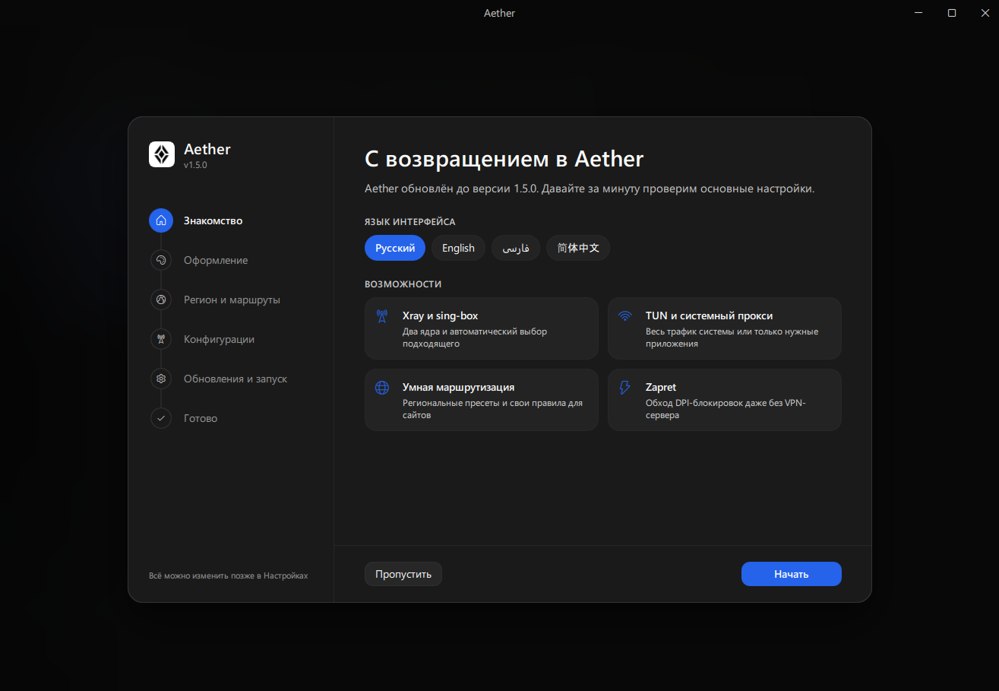
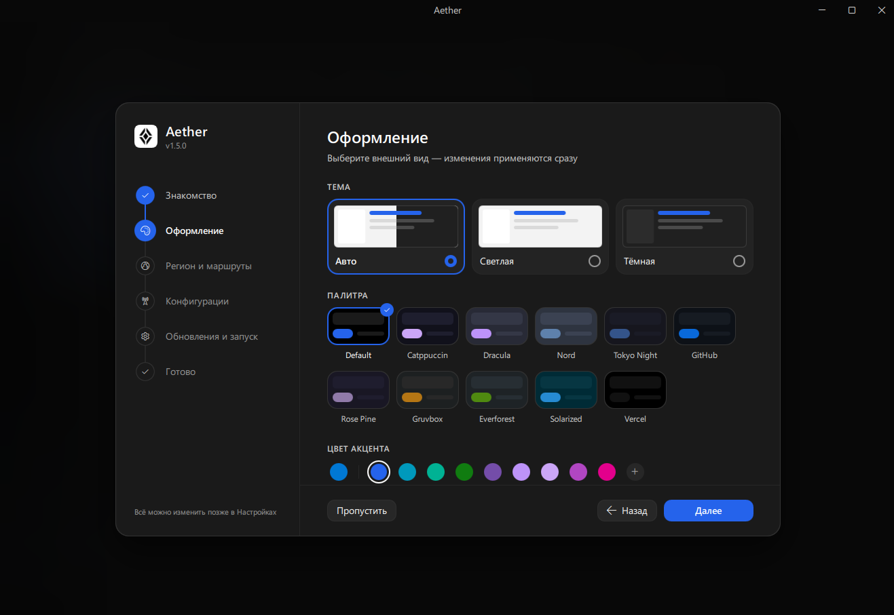
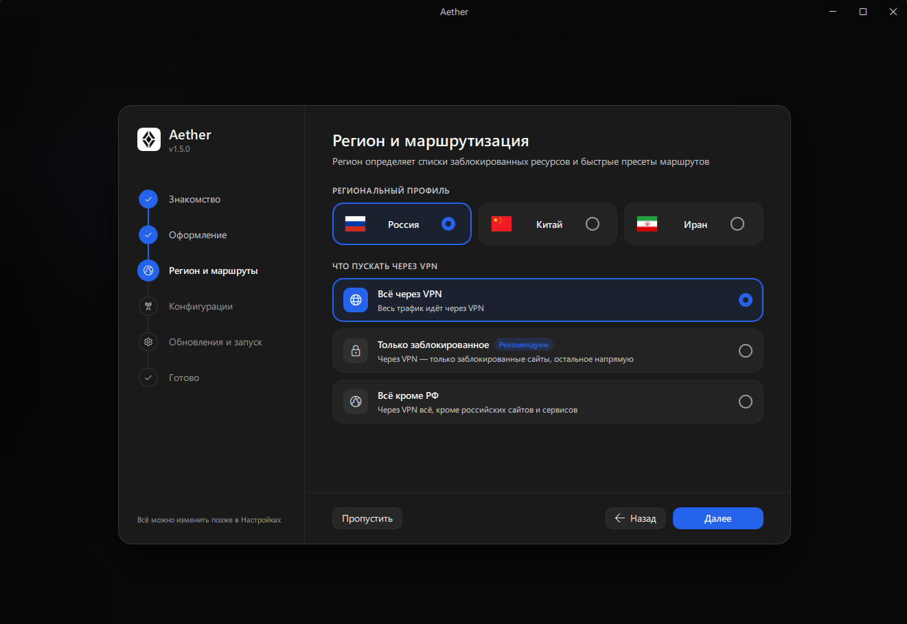
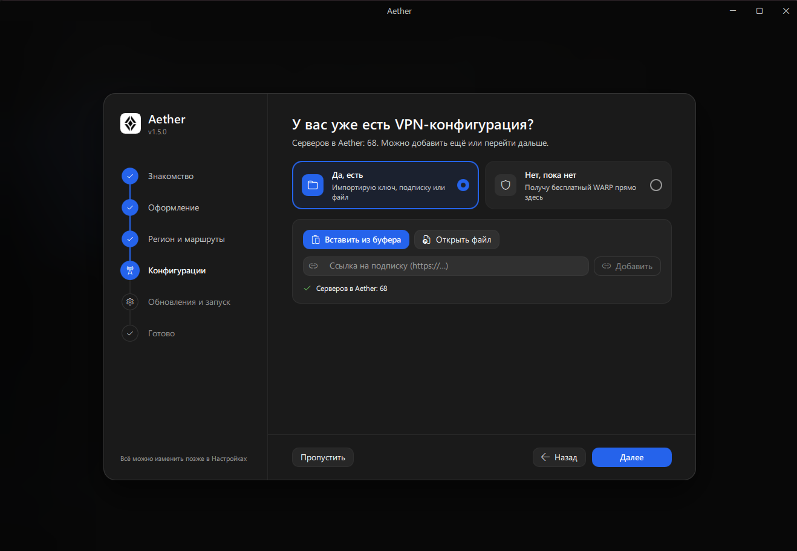
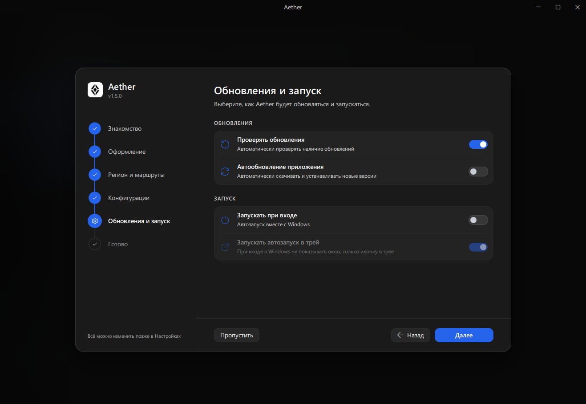
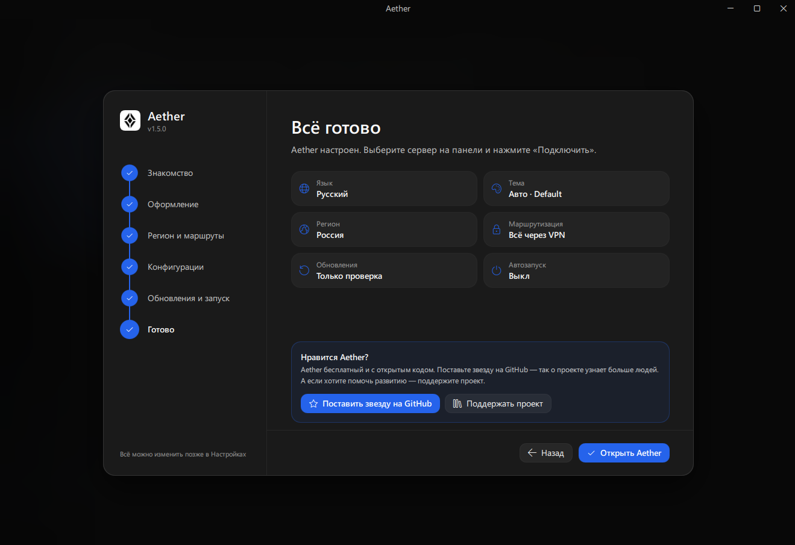

# Aether (v1.5.0)

<p align="center">
  
</p>

<p align="center">
  <b>Современный, производительный и универсальный клиент для обхода блокировок и управления VPN под Windows</b>
</p>

<p align="center">
  <b>Русский</b> | <a href="README_EN.md">English</a>
</p>

<p align="center">
  <a href="https://github.com/ch1burek-lol/Aether/releases"></a>
  <a href="https://www.python.org/"></a>
  <a href="https://doc.qt.io/qt-6/qtquick-index.html"></a>
  <a href="LICENSE"></a>
  <a href="https://www.donationalerts.com/r/ch1burek"></a>
</p>

---

## Содержание

- [О проекте](#о-проекте)
- [Скриншоты и мастер начальной настройки](#скриншоты-и-мастер-начальной-настройки)
- [Ключевые возможности](#ключевые-возможности)
  - [1. Режимы работы](#1-режимы-работы)
  - [2. Поддерживаемые протоколы](#2-поддерживаемые-протоколы)
  - [3. Умная маршрутизация](#3-умная-маршрутизация)
  - [4. Готовые пресеты Zapret](#4-готовые-пресеты-zapret)
  - [5. Мониторинг сети и трафик процессов](#5-мониторинг-сети-и-трафик-процессов)
- [Установка](#установка)
- [Сборка из исходного кода](#сборка-из-исходного-кода)
- [Структура проекта](#структура-проекта)
- [История изменений (v1.5.0)](#история-изменений-v150)
- [Частые вопросы и решение проблем (FAQ)](#частые-вопросы-и-решение-проблем-faq)
- [Поддержка проекта](#поддержка-проекта)
- [Лицензия](#лицензия)

---

## О проекте

**Aether** — это передовой клиент для Windows, объединяющий под одним капотом полноценный сетевой туннель (VPN), быстрый системный прокси и автономный движок противодействия DPI-фильтрации провайдеров (**Zapret**).

В основе Aether v1.5.0 лежит полностью переработанная архитектура на базе **Python 3.12** и **Qt Quick (QML / PyQt6)**. Мы отказались от браузерных надстроек (WebView2, Electron) в пользу аппаратного GPU-рендеринга и прямого взаимодействия с низкоуровневыми сетевыми интерфейсами Windows. Это обеспечило:
* **Мгновенный отклик интерфейса:** стабильные 60/120 FPS без задержек и подвисаний.
* **Минимальное потребление памяти:** программа занимает в 4-5 раз меньше RAM по сравнению с веб-оболочками.
* **Нативный Fluent Design:** органично вписывается в стиль Windows 11 с поддержкой тёмной темы и кастомных акцентных цветов.

---

## Скриншоты и мастер начальной настройки

При первом запуске Aether предлагает пошаговый мастер (Onboarding), позволяющий за полминуты настроить внешний вид, маршруты и источники трафика под свои задачи:

### 1. Добро пожаловать
Начальный экран приветствия знакомит пользователя с возможностями приложения и подготавливает рабочее окружение.

<p align="center">
  
</p>

---

### 2. Оформление
Выбор внешнего вида: тёмная или светлая тема, настройка акцентного цвета интерфейса, адаптивные переключатели и сглаженные карточки в стиле Fluent Design.

<p align="center">
  
</p>

---

### 3. Регион и маршрутизация
Тонкая настройка правил направления трафика. Позволяет выбрать ваш регион (Россия, Иран и др.) и режим раздельного туннелирования: пропускать только заблокированные ресурсы через прокси, а важные локальные сервисы (банки, Госуслуги, маркетплейсы) оставлять на прямом подключении.

<p align="center">
  
</p>

---

### 4. Конфигурация: У вас уже есть VPN?
Выбор источника соединения. Вы можете подключить свою готовую подписку (VLESS, Hysteria 2, ShadowTLS, Shadowsocks, Trojan, VMess) либо использовать автономный локальный режим **Zapret (DPI Bypass)**, который не требует наличия собственного зарубежного сервера.

<p align="center">
  
</p>

---

### 5. Обновление и запуск
Настройка автозапуска вместе с Windows, тихий запуск в системный трей и проверка обновлений для поддержания ядер и баз данных в актуальном состоянии.

<p align="center">
  
</p>

---

### 6. Всё готово!
Завершающий шаг: профиль применён, сетевые адаптеры инициализированы, клиент полностью готов к работе в один клик.

<p align="center">
  
</p>

---

## Ключевые возможности

### 1. Режимы работы

* **Zapret (Автономный DPI Bypass без VPN):**
  Модифицирует TCP и UDP пакеты на лету с помощью драйвера WinDivert (winws2), позволяя обходить замедления провайдеров без передачи личных данных на сторонние серверы. Идеально подходит для YouTube, Discord и веб-серфинга на скорости вашего домашнего провайдера (до 1 Гбит/с и выше).
* **VPN TUN (Wintun виртуальный адаптер):**
  Создаёт полноценный виртуальный сетевой интерфейс на базе драйвера Wintun. Направляет трафик всей операционной системы (включая онлайн-игры, клиент Steam, голосовой протокол Discord RTC и системные утилиты).
* **Системный прокси (System Proxy):**
  Классический режим проксирования через настройки Windows Internet Settings. Не требует административных привилегий при каждом запуске и подходит для браузеров и офисных программ.

---

### 2. Поддерживаемые протоколы

Aether использует сборки ядер **Sing-box Extended** и **Xray-core**, обеспечивая поддержку самых современных протоколов маскировки:
* **VLESS:** с поддержкой **Reality** и Flow Vision (полная маскировка под реальные TLS-сертификаты крупных сайтов).
* **Hysteria 2:** скоростной протокол на базе QUIC/UDP, пробивающий агрессивные ограничения провайдеров.
* **Shadowsocks & ShadowTLS:** надёжные и проверенные временем методы шифрования.
* **Trojan / VMess:** совместимость с классическими прокси-серверами.
* **WireGuard & Cloudflare WARP:** прямое подключение к глобальной сети.

---

### 3. Умная маршрутизация

Вам больше не нужно постоянно включать и выключать VPN, чтобы зайти в онлайн-банк или государственные сервисы:
* **Только заблокированное (Antizapret):** Трафик идёт через прокси исключительно для доменов и IP из постоянно обновляемых списков блокировок (GeoSite / GeoIP). Все российские ресурсы работают напрямую с нулевым пингом.
* **Всё кроме РФ:** Международный трафик защищён и направлен через сервер, трафик в зоне `.ru` идёт через вашего локального провайдера.
* **Полный туннель:** Абсолютно весь трафик без исключений направляется в зашифрованный канал.

---

### 4. Готовые пресеты Zapret

В приложении предустановлены проверенные конфигурации обхода:
* **YouTube:** Полная разблокировка воспроизведения видео в 1080p, 2K и 4K 60FPS без буферизации.
* **Discord (Voice & RTC):** Восстановление работы голосовых каналов, звонков и медиа-серверов Discord без задержек.
* **Roblox (Ассеты и текстуры):** Специфический обход для CDN-серверов Roblox (`rbxcdn.com`, `assetdelivery.roblox.com`). Разблокирует скины, одежду, звуки и текстуры карт, не затрагивая игровой UDP-трафик серверов (0 ms прибавки к игровому пингу и защита от дисконнектов 277/279).
* **Универсальные профили:** Пресеты для Telegram, обхода блокировок сайтов СМИ и соцсетей.

---

### 5. Мониторинг сети и трафик процессов

* **Живые графики скорости:** Динамическое отображение скорости входящего и исходящего каналов в реальном времени.
* **Трафик приложений:** Встроенная таблица сетевой активности показывает, какие именно программы (`chrome.exe`, `discord.exe`, `RobloxPlayerBeta.exe`) передают данные через туннель и сколько байт израсходовано.
* **Проверка пинга (RTT):** Быстрый замер задержки до всех добавленных серверов с визуальным цветовым индикатором качества связи.

---

## Установка

Готовые файлы доступны на странице **[Releases](https://github.com/ch1burek-lol/Aether/releases)**:

1. Скачайте инсталлятор **`Aether-Setup-windows-x64.exe`**.
2. Запустите установку и следуйте подсказкам мастера.
3. При первом запуске мастер Onboarding поможет выбрать подходящий режим за несколько кликов.

*(Также доступен архив **`Aether-portable-windows-x64.zip`**, не требующий установки в систему).*

---

## Сборка из исходного кода

Если вы хотите собрать приложение самостоятельно:

### Требования:
- Windows 10 или 11 (64-bit)
- Python 3.11 или 3.12
- Git
- [Inno Setup 6](https://jrsoftware.org/isdl.php) *(необходим только для компиляции итогового инсталлятора)*

### Пошаговая сборка:
```bash
# 1. Клонируйте репозиторий
git clone https://github.com/ch1burek-lol/Aether.git
cd Aether/windows

# 2. Создайте изолированное виртуальное окружение
python -m venv ..\.venv
..\.venv\Scripts\activate

# 3. Установите зависимости
pip install -r requirements.txt

# 4. Запуск в режиме разработки
python run_qml.py

# 5. Сборка готового дистрибутива и инсталлятора
python build_qml.py
```
После успешного завершения сборки готовый исполняемый файл и установщик появятся в каталоге `windows/dist/`.

---

## Структура проекта

```text
Aether/
├── assets/                     # Иконки, логотипы и скриншоты для документации
│   ├── Aether.ico
│   ├── Aether.png
│   └── Screenshots/            # Скриншоты мастера настройки (1-6)
├── windows/
│   ├── core/                   # Бинарные ядра (sing-box, xray, wintun, geodata)
│   ├── zapret/                 # Движок winws2, списки доменов и пресеты правил
│   │   ├── presets/            # Готовые профили (YouTube, Discord, Roblox и др.)
│   │   └── lists/              # Списки адресов и доменов
│   ├── xray_fluent/            # Ядро приложения и мосты к интерфейсу
│   │   ├── qml_app/            # Компоненты интерфейса Qt Quick (QML)
│   │   ├── app_updater.py      # Модуль фонового обновления
│   │   └── win_proc_monitor.py # Монитор сетевой активности процессов
│   ├── run_qml.py              # Точка входа для запуска
│   └── build_qml.py            # Скрипт автоматизированной сборки
├── README.md                   # Документация проекта
└── LICENSE                     # Лицензия GPLv3
```

---

## История изменений (v1.5.0)

Релиз **v1.5.0** — крупнейшее обновление Aether, в котором приложение было переписано с чистого листа:

* **Новый графический движок Qt Quick (QML) + PyQt6:**
  - Полный отказ от WebView2, Chromium и браузерных обёрток.
  - Мгновенный запуск, плавные 60/120 FPS анимации и сниженное в несколько раз потребление оперативной памяти.
  - Кастомная дизайн-система Fluent Design: переключатели, акцентные темы, контекстные меню и всплывающие окна.
* **Встроенный модуль Zapret (winws2):**
  - Поддержка автономного обхода DPI без аренды сторонних серверов.
  - Интеграция готовых пресетов для YouTube, голосовых серверов Discord (RTC) и сайтов.
  - Добавлен специализированный пресет для Roblox (ассеты и текстуры через TCP 80/443), предотвращающий рост пинга в игровых матчах.
* **Обновлённый сетевой стек:**
  - Поддержка ядер Sing-box Extended и Xray-core с переключением в реальном времени.
  - Реализованы протоколы VLESS Reality, Hysteria 2, ShadowTLS, Shadowsocks, Trojan, VMess.
  - Полноценная интеграция Wintun: виртуальный системный адаптер для игр и приложений без поддержки прокси.
  - Предотвращение утечек DNS и IPv6.
* **Монитор процессов и трафика:**
  - Живой учёт исходящего и входящего трафика с детализацией по конкретным исполняемым файлам (`.exe`).
  - Фильтрация фонового трафика и корректное определение процессов через Windows EStats API.
* **Автоматическое обновление:**
  - Встроенный механизм проверки и скачивания новых релизов в 1 клик прямо с GitHub.
  - Автономное обновление ядер Sing-box, Xray и баз правил GeoIP/GeoSite без переустановки всей программы.

---

## Частые вопросы и решение проблем (FAQ)

<details>
<summary><b>Нужны ли права Администратора для работы Aether?</b></summary>
Для базового режима «Системный прокси» права администратора не требуются. Однако для режимов <b>VPN TUN (Wintun)</b> и <b>Zapret</b> права администратора необходимы, так как они работают напрямую с сетевыми драйверами ядра Windows. Рекомендуется запускать Aether от имени Администратора для доступа ко всем функциям.
</details>

<details>
<summary><b>Почему в трафике приложений иногда отображается 0 B?</b></summary>
В операционной системе Windows статистика TCP/IP соединений конкретных процессов (API <code>GetPerTcpConnectionEStats</code>) доступна только при наличии прав Администратора. Если программа запущена в обычном режиме, Windows возвращает ошибку «Access Denied», и данные по процессам не могут быть прочитаны. Запустите Aether от Администратора, чтобы видеть трафик приложений.
</details>

<details>
<summary><b>Что делать, если при сборке файл Monkey64.sys заблокирован?</b></summary>
<code>Monkey64.sys</code> — это драйвер ядра службы WinDivert, используемый Zapret. Если драйвер остался в памяти, откройте PowerShell от Администратора и выполните:
<pre>taskkill /F /IM winws.exe /IM winws2.exe 2>$null; sc.exe stop Monkey; sc.exe delete Monkey</pre>
После остановки службы файл разблокируется.
</details>

<details>
<summary><b>Работают ли российские сервисы и банки при включённом Aether?</b></summary>
Да! При использовании режима маршрутизации «Только заблокированное» весь трафик российских доменов, банков (Сбер, Т-Банк и др.), Госуслуг и маркетплейсов направляется напрямую мимо туннеля на максимальной скорости вашего провайдера.
</details>

---

## Поддержка проекта

Если вам нравится Aether и вы хотите поддержать дальнейшую разработку:
* Поставьте звезду **Star** ⭐️ нашему репозиторию на GitHub.
* Сообщайте об ошибках и предлагайте идеи в разделе [Issues](https://github.com/ch1burek-lol/Aether/issues).
* Поддержать разработчика материально: [DonationAlerts](https://www.donationalerts.com/r/ch1burek).

---

## Лицензия

Проект распространяется под свободной лицензией **GNU General Public License v3.0 (GPLv3)**. Подробный текст лицензии доступен в файле [LICENSE](LICENSE).
