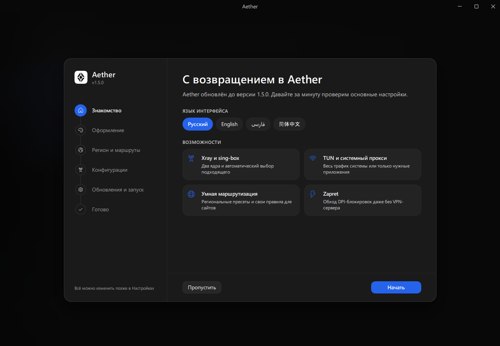
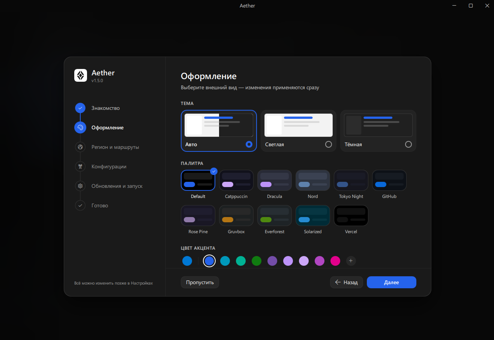
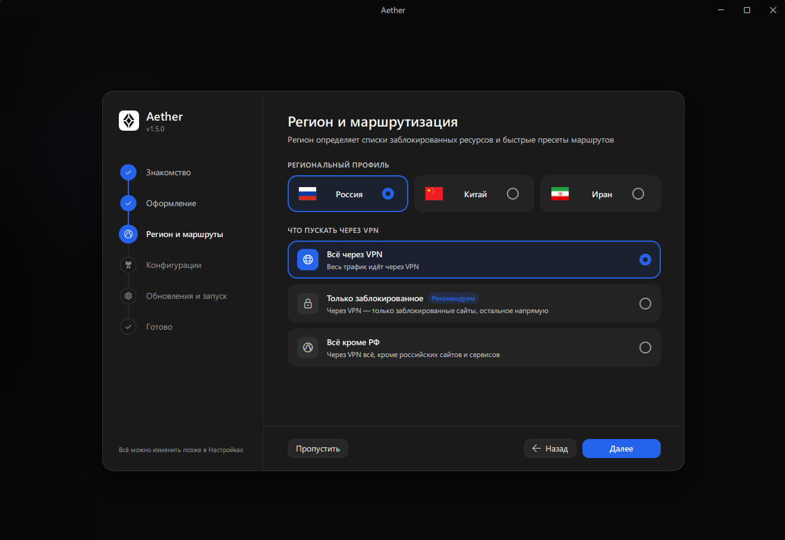
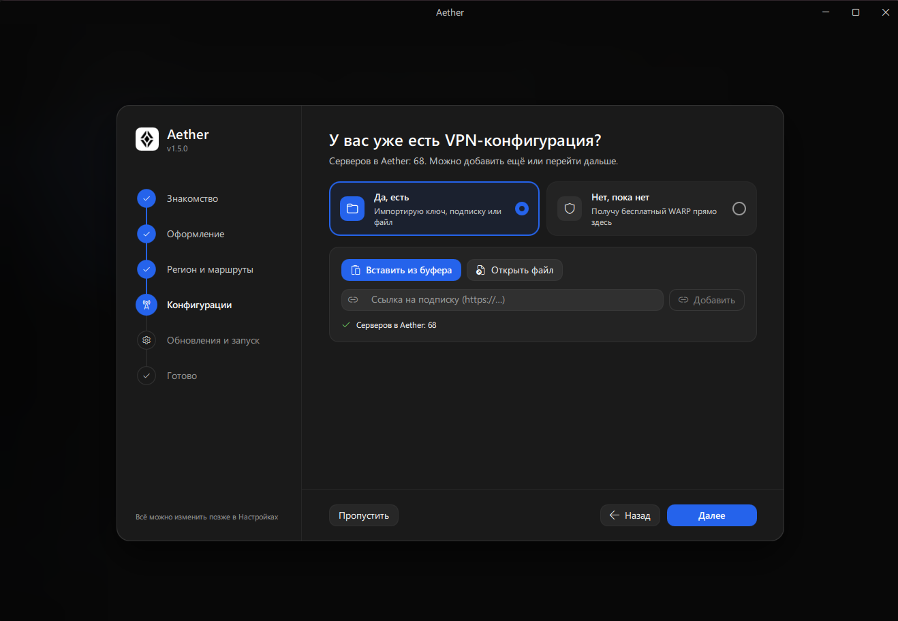
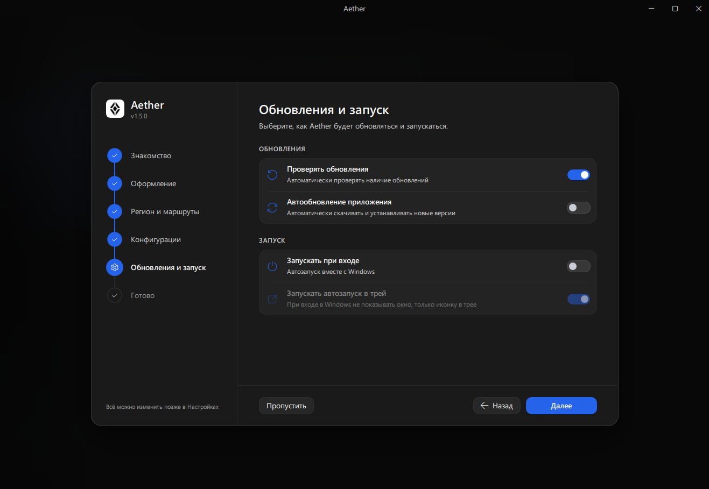
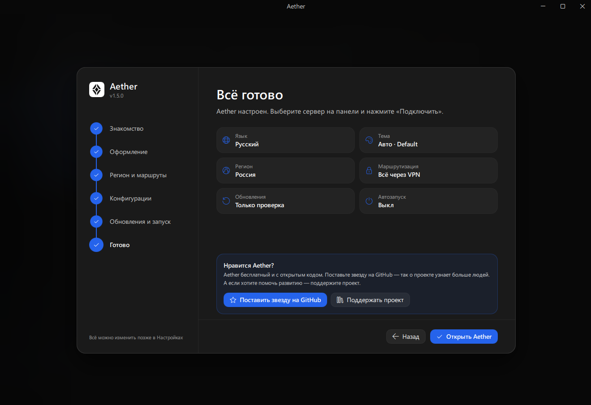

# Aether (v1.5.0)

<p align="center">
  
</p>

<p align="center">
  <b>Modern, lightweight, and versatile Windows client for anti-censorship, proxy, and VPN management</b>
</p>

<p align="center">
  <a href="README.md">Русский</a> | <b>English</b>
</p>

<p align="center">
  <a href="https://github.com/ch1burek-lol/Aether/releases"></a>
  <a href="https://www.python.org/"></a>
  <a href="https://doc.qt.io/qt-6/qtquick-index.html"></a>
  <a href="LICENSE"></a>
  <a href="https://www.donationalerts.com/r/ch1burek"></a>
</p>

---

## Table of Contents

- [About The Project](#about-the-project)
- [Onboarding Setup Wizard & Screenshots](#onboarding-setup-wizard--screenshots)
- [Key Features](#key-features)
  - [1. Operational Modes](#1-operational-modes)
  - [2. Supported Protocols](#2-supported-protocols)
  - [3. Smart Routing](#3-smart-routing)
  - [4. Zapret DPI Presets](#4-zapret-dpi-presets)
  - [5. Live Network & Process Traffic Monitor](#5-live-network--process-traffic-monitor)
- [Installation](#installation)
- [Building from Source](#building-from-source)
- [Project Structure](#project-structure)
- [Changelog (v1.5.0)](#changelog-v150)
- [Frequently Asked Questions (FAQ)](#frequently-asked-questions-faq)
- [Support & Donations](#support--donations)
- [License](#license)

---

## About The Project

**Aether** is an advanced Windows client combining a system-wide VPN tunnel, an instant system proxy, and a standalone DPI-circumvention engine (**Zapret / winws2**) into a unified, high-performance desktop application.

In version **1.5.0**, the project underwent a full architectural rewrite based on **Python 3.12** and **Qt Quick (QML / PyQt6)**. We completely removed heavyweight web engines (WebView2, Chromium, Electron) in favor of hardware-accelerated GPU rendering and direct interaction with low-level Windows network APIs. Benefits include:
* **Instant UI responsiveness:** smooth 60/120 FPS animations without interface latency.
* **Minimal memory footprint:** consumes 4-5 times less RAM compared to browser-based frameworks.
* **Native Fluent Design:** seamlessly adapts to Windows 11 design guidelines with dark theme support and customizable accent colors.

---

## Onboarding Setup Wizard & Screenshots

On its first launch, Aether presents a streamlined onboarding wizard to configure themes, routing rules, and connection modes in seconds:

### 1. Welcome
The welcome step introduces features and initializes the local environment.

<p align="center">
  
</p>

---

### 2. Appearance
Visual personalization: dark/light theme, custom accent colors, smooth switches, and rounded cards adhering to modern Fluent Design.

<p align="center">
  
</p>

---

### 3. Region & Routing
Fine-tuned traffic control. Configure your local region and split-tunneling policies: route only restricted resources through the proxy while keeping banking apps, local services, and marketplaces directly connected at native ISP speeds.

<p align="center">
  
</p>

---

### 4. Configuration: Do you have a VPN?
Choose your connectivity source: connect existing server subscriptions (VLESS, Hysteria 2, ShadowTLS, Shadowsocks, Trojan, VMess) or use the standalone **Zapret (DPI Bypass)** mode without renting a remote VPS.

<p align="center">
  
</p>

---

### 5. Updates & Startup
Configure auto-start with Windows, silent startup to the system tray, and background updates to keep cores and routing databases fresh.

<p align="center">
  
</p>

---

### 6. All Set!
Finalization: settings applied, network adapters initialized, client ready for one-click connection.

<p align="center">
  
</p>

---

## Key Features

### 1. Operational Modes

* **Zapret (Standalone DPI Bypass without VPN):**
  Modifies TCP/UDP packet headers on the fly via the WinDivert driver (`winws2`), bypassing ISP throttling and blocks without routing data through third-party servers. Ideal for YouTube 4K, Discord RTC voice, and high-speed browsing directly through your local ISP bandwidth (up to 1+ Gbps).
* **VPN TUN (Wintun Virtual Adapter):**
  Creates a virtual network adapter using the high-performance Wintun kernel driver. Routes entire OS traffic (online games, Steam, Discord voice, torrents, console tools).
* **System Proxy:**
  Classic proxy mode integrated with Windows Internet Settings. Requires no admin privileges to start and is perfect for web browsers and office apps.

---

### 2. Supported Protocols

Aether bundles modern **Sing-box Extended** and **Xray-core** builds, delivering broad protocol support:
* **VLESS:** equipped with **Reality** and Flow Vision TLS impersonation.
* **Hysteria 2:** QUIC/UDP-based protocol cutting through aggressive network throttling.
* **Shadowsocks & ShadowTLS:** reliable and battle-tested obfuscation.
* **Trojan & VMess:** full backward compatibility with standard proxy infrastructures.
* **WireGuard & Cloudflare WARP:** clean, direct connectivity.

---

### 3. Smart Routing

No need to toggle your connection on and off when accessing local banking or government portals:
* **Blocked Only (Antizapret):** Only domains and IPs present in frequently updated blocklists (GeoSite / GeoIP) route through the proxy. Local sites open directly at 0 ms added latency.
* **Bypass Local Region:** International traffic goes through the secure tunnel, while domestic traffic stays direct.
* **Global Tunnel:** All system traffic is routed through the encrypted connection.

---

### 4. Zapret DPI Presets

Pre-configured and tested profiles for instant use:
* **YouTube:** Full resolution unlock for 1080p, 2K, and 4K 60FPS video playback without buffering.
* **Discord (Voice & RTC):** Restores voice channels, direct calls, and media gateways without latency.
* **Roblox (Assets & Textures):** Dedicated TCP 80/443 rule for Roblox CDN domains (`rbxcdn.com`, `assetdelivery.roblox.com`). Fixes missing skins, clothes, and audio without altering in-game UDP server traffic (0 ms added ping and no 277/279 match disconnects).
* **General Profiles:** Universal presets for Telegram, blocked media outlets, and social platforms.

---

### 5. Live Network & Process Traffic Monitor

* **Real-time Speed Graphs:** Dynamic upload and download bandwidth charts.
* **Per-Process Traffic Accounting:** Shows exactly which programs (`chrome.exe`, `discord.exe`, `RobloxPlayerBeta.exe`) are communicating through the tunnel and how much data they transfer.
* **Latency Check (RTT Ping):** Quick ping checks for all configured servers with intuitive color indicators.

---

## Installation

Ready-to-use binaries are available on the **[Releases](https://github.com/ch1burek-lol/Aether/releases)** page:

1. Download **`Aether-Setup-windows-x64.exe`**.
2. Run the installer and follow the on-screen steps.
3. Launch Aether and complete the quick Onboarding Wizard.

*(A standalone archive **`Aether-portable-windows-x64.zip`** is also provided for portable usage without installation).*

---

## Building from Source

### Prerequisites:
- Windows 10 or 11 (64-bit)
- Python 3.11 or 3.12
- Git
- [Inno Setup 6](https://jrsoftware.org/isdl.php) *(required only for building the setup installer)*

### Step-by-Step Build:
```bash
# 1. Clone repository
git clone https://github.com/ch1burek-lol/Aether.git
cd Aether/windows

# 2. Create isolated virtual environment
python -m venv ..\.venv
..\.venv\Scripts\activate

# 3. Install dependencies
pip install -r requirements.txt

# 4. Launch in development mode
python run_qml.py

# 5. Build distribution binary & installer
python build_qml.py
```
Compiled binaries and the setup installer will be placed in `windows/dist/`.

---

## Project Structure

```text
Aether/
├── assets/                     # Icons, logos, and screenshots for documentation
│   ├── Aether.ico
│   ├── Aether.png
│   └── Screenshots/            # Setup Wizard screenshots (1-6)
├── windows/
│   ├── core/                   # Binary cores (sing-box, xray, wintun, geodata)
│   ├── zapret/                 # winws2 engine, lists, and presets
│   │   ├── presets/            # Built-in presets (YouTube, Discord, Roblox, etc.)
│   │   └── lists/              # Host lists and domain files
│   ├── xray_fluent/            # Application core and Qt bridges
│   │   ├── qml_app/            # Qt Quick (QML) UI components
│   │   ├── app_updater.py      # Background update worker
│   │   └── win_proc_monitor.py # Process network activity monitor
│   ├── run_qml.py              # Application entry point
│   └── build_qml.py            # Automated packaging script
├── README.md                   # Russian documentation
├── README_EN.md                # English documentation
└── LICENSE                     # GPLv3 License
```

---

## Changelog (v1.5.0)

Version **v1.5.0** represents a comprehensive, ground-up rewrite:

* **New Qt Quick (QML) + PyQt6 Engine:**
  - Complete deprecation of WebView2 and Chromium wrappers.
  - Near-instant startup, smooth 60/120 FPS animations, and drastically lower RAM usage.
  - Bespoke Fluent Design system: responsive controls, accent theme engine, and popups.
* **Integrated Zapret (winws2) Engine:**
  - Standalone DPI bypass without requiring an external proxy server.
  - Out-of-the-box presets for YouTube, Discord RTC voice, and media gateways.
  - Dedicated Roblox asset preset targeting CDN endpoints via TCP 80/443 without inflating game UDP ping.
* **Modernized Network Stack:**
  - Support for Sing-box Extended and Xray-core with dynamic switching.
  - Protocol implementations: VLESS Reality, Hysteria 2, ShadowTLS, Shadowsocks, Trojan, VMess.
  - Robust Wintun integration: system-level virtual adapter for games and non-proxy software.
  - Leak-proof DNS handling and IPv6 protection.
* **Process Traffic Monitoring:**
  - Live inbound and outbound stats broken down per executable (`.exe`).
  - Integration with Windows EStats API for accurate process identification.
* **Automated Updates:**
  - Single-click background updates directly from GitHub releases.
  - Independent updates for Sing-box, Xray, and GeoIP/GeoSite rule-sets.

---

## Frequently Asked Questions (FAQ)

<details>
<summary><b>Does Aether require Administrator privileges?</b></summary>
The basic "System Proxy" mode runs without administrative rights. However, <b>VPN TUN (Wintun)</b> and <b>Zapret</b> require Administrator rights to interact with kernel-level Windows drivers. Running Aether as Administrator is recommended for full functionality.
</details>

<details>
<summary><b>Why does the process traffic table show 0 B?</b></summary>
Windows restricts TCP connection metrics (via the <code>GetPerTcpConnectionEStats</code> API) to elevated processes. Without Administrator rights, Windows denies access to per-PID socket byte counts. Running Aether as Administrator restores full process traffic accounting.
</details>

<details>
<summary><b>What if Monkey64.sys is locked during a rebuild?</b></summary>
<code>Monkey64.sys</code> is the WinDivert kernel driver used by Zapret. If still held by a background service, open an elevated PowerShell prompt and execute:
<pre>taskkill /F /IM winws.exe /IM winws2.exe 2>$null; sc.exe stop Monkey; sc.exe delete Monkey</pre>
This unloads the kernel service and frees the file.
</details>

<details>
<summary><b>Do local services and banks work when Aether is active?</b></summary>
Yes. In "Blocked Only" mode, local banking platforms, public services, and marketplaces bypass the tunnel entirely, communicating at native ISP speeds with zero added latency.
</details>

---

## Support & Donations

If you appreciate Aether:
* Star the repository on GitHub ⭐️ to support further development!
* Report issues and propose features in the [Issues](https://github.com/ch1burek-lol/Aether/issues) tab.
* Donate: [DonationAlerts](https://www.donationalerts.com/r/ch1burek).

---

## License

Distributed under the **GNU General Public License v3.0 (GPLv3)**. For more details, see [LICENSE](LICENSE).
